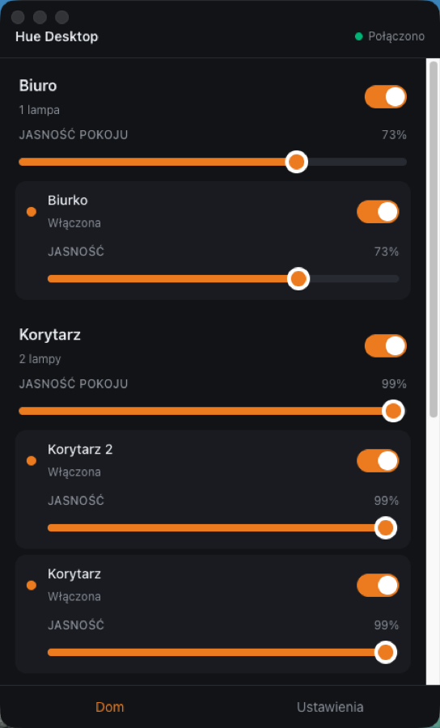

<div align="center">

[English](README.md) | Polski


# Lumen Desktop

**Steruj inteligentnym oświetleniem z pulpitu, bez sięgania po telefon.**

Lekka aplikacja desktopowa na macOS, Windows i Linuksa. Rozmawia z mostkiem Philips Hue
i z żarówkami opartymi na Tuya bezpośrednio przez sieć lokalną, a z całą resztą przez
Twój własny Home Assistant. Kilka hubów naraz, jeden ekran. Bez naszego backendu,
bez konta, bez chmury.

</div>

---

<div align="center">

</div>

## Co potrafi

- **Kilka hubów naraz**: mostek Hue w przedpokoju, żarówka Tuya na biurku i Home
  Assistant obsługujący resztę pojawiają się jako jedna lista, a nie trzy aplikacje
- **Znajduje mostek**: mDNS, `discovery.meethue.com`, ostatni znany adres albo ręcznie
  wpisany IP; paruje przez fizyczny przycisk i zapamiętuje mostek
- **Łączy się z Home Assistantem** za pomocą adresu i długoterminowego tokenu dostępu
- **Znajduje urządzenia Tuya**, nasłuchując tego, co rozgłaszają, albo skanując zakres
  adresów, i steruje nimi wprost przez sieć LAN za pomocą ich klucza lokalnego:
  protokoły 3.3, 3.4 i 3.5, bez chmury, bez huba, działa bez internetu
- **Steruje lampami**: włącz/wyłącz, jasność, temperatura barwowa, kolor RGB
- **Steruje pokojami** jednym zgrupowanym żądaniem zamiast jednej komendy na żarówkę
- **Włącza sceny** zapisane w hubie, pogrupowane według pokojów
- **Ulubione**: przypnij pokój, lampę albo scenę na górze ekranu
- **Pasek menu**: sterowanie bez otwierania okna, z ulubionymi i opcją „wyłącz wszystko"
- **Skróty klawiszowe** działające globalnie, także gdy aplikacja jest w tle
- **Szybkie akcje**: jedno kliknięcie dla tego, co robisz najczęściej
- **Automatyzacje** utworzone w hubie: podgląd i wstrzymywanie
- **Uruchamianie przy logowaniu**, od razu do paska menu
- **Reaguje na zmiany z zewnątrz**: włącznik ścienny, aplikacja producenta albo asystent
  głosowy odświeżają widok natychmiast, dzięki strumieniowi zdarzeń Hue v2 i WebSocketowi
  Home Assistanta
- **Wraca po zerwanym połączeniu**: wykładniczy backoff osobno dla każdego huba, więc
  milczenie jednego nic nie mówi o pozostałych, a gdy DHCP zmieni adres mostka, aplikacja
  odnajduje go ponownie po identyfikatorze

Kontrolki dopasowują się do możliwości sprzętu: zwykła żarówka White dostaje tylko
włącznik, White Ambiance dodaje temperaturę, a żarówka kolorowa pełny selektor barw.

### Jakie żarówki obsługuje?

Trzy drogi, od najbardziej bezpośredniej:

- **Philips Hue**, przez mostek w Twojej sieci.
- **Tuya**, prosto do urządzenia. Bardzo wiele marek to pod spodem Tuya, choć nigdzie
  tego nie piszą, w tym **Spectrum Smart**. Jeśli żarówka paruje się z aplikacją Tuya
  Smart albo Smart Life, lub z aplikacją producenta zbudowaną na tym samym SDK, ta
  aplikacja rozmawia z nią bezpośrednio. Potrzebny jest jej *klucz lokalny*; zobacz
  [Urządzenia Tuya](#urządzenia-tuya).
- **Cała reszta**, przez Twój własny Home Assistant. Jeśli Home Assistant widzi lampę,
  widzi ją też ta aplikacja, bez osobnego kodu dla każdej marki.

### Urządzenia Tuya

Urządzenie Tuya szyfruje ruch w sieci LAN 16-znakowym **kluczem lokalnym**, nadawanym
podczas parowania i przechowywanym w dokładnie dwóch miejscach: w firmware urządzenia
i w chmurze Tuya. Nie da się go odczytać z urządzenia, więc trzeba raz zapytać chmurę:

1. Utwórz darmowy projekt na `iot.tuya.com`. **Wybierz centrum danych, w którym jest
   Twoje konto**, dla większości UE jest to Central Europe.
2. Zasubskrybuj w projekcie *IoT Core* i *Authorization Token Management*.
3. *Devices → Link App Account* i zeskanuj kod QR swoją aplikacją.
4. W *Add a hub → Tuya* wpisz **Access ID** i **Access Secret** projektu i wybierz
   *Get my devices*. Aplikacja odczyta nazwę i klucz lokalny każdego urządzenia, znajdzie
   urządzenia w Twojej sieci i wstępnie zaznaczy lampy.

Access Secret służy tylko do tego jednego żądania i nie jest zapisywany. Potem chmura
nie jest już używana: możesz unieważnić klucz projektu, a aplikacja działa dalej. Klucze
lokalne są przechowywane w postaci zaszyfrowanej, jak każde inne poświadczenie, i nigdy
nie opuszczają Twojego komputera.

Masz już klucze z `tinytuya wizard` albo z innego źródła? Wpisz je w wierszach urządzeń;
krok z kontem jest opcjonalny.

Urządzenie, które się nie pojawia, bo akurat milczy albo stoi za siecią gubiącą
rozgłoszenia, można znaleźć przyciskiem **Scan**: sprawdza on każdy adres w sieci
lokalnej albo jeden wpisany adres lub zakres (`192.168.1.40`, `192.168.1.0/24`)
i rozpoznaje urządzenia po ich kluczach.

Ponowne sparowanie urządzenia nadaje mu nowy klucz lokalny, co aplikacja zgłasza jako
utratę autoryzacji, zamiast ponawiać próby w nieskończoność.

Urządzenie Tuya ogłasza tylko swój identyfikator: nic nie mówi, czy to żarówka, gniazdko
czy termometr. Aplikacja ustala to na podstawie punktów danych, które urządzenie zgłasza
przy pierwszej odpowiedzi, zostawia lampy i informuje, czym była reszta. Dzięki temu
czujnik wklejony do niewłaściwego wiersza nie trafi na listę jako lampa z martwymi
kontrolkami.

## Widżet macOS

Aplikacja zawiera rozszerzenie WidgetKit: widżet pokazujący stan oświetlenia, dostępny
w Centrum powiadomień i na biurku. Dwa rozmiary:

- **mały**: ile lamp świeci spośród wszystkich,
- **średni**: lista pokojów z jasnością każdego z nich.

Aby go dodać: kliknij prawym przyciskiem biurko → *Edytuj widżety*, znajdź **Lumen
Desktop** i przeciągnij wybrany rozmiar. Aplikacja musi znajdować się w `/Applications`.

Widżet **steruje oświetleniem**: w małym rozmiarze cały kafelek jest przełącznikiem
„wszystko wł./wył.", w średnim każdy pokój ma własny przycisk.

Widżet sam łączy się z hubami, więc działa **nawet przy zamkniętej aplikacji**. Wymaga to
wyeksportowania poświadczeń do współdzielonego kontenera App Group (plik z uprawnieniami
`0600`), a oba rodzaje poświadczeń są traktowane inaczej:

- **Hue** jest eksportowany zawsze. Klucz aplikacji daje jedynie kontrolę nad
  oświetleniem w sieci lokalnej, nie jest poświadczeniem konta, a rozparowanie usuwa
  plik. TLS jest weryfikowany dokładnie tak jak w aplikacji: ten sam CA Signify, to samo
  porównanie Common Name z identyfikatorem mostka.
- **Home Assistant jest domyślnie wyłączony.** Długoterminowy token daje dostęp do całego
  API (zamki, kamery, alarmy) i działa zdalnie, jeśli instancja jest wystawiona na
  zewnątrz, więc to coś zupełnie innego niż klucz Hue. Włącz go w *Settings → Widget*,
  jeśli chcesz, żeby widżet przełączał te pokoje. Gdy jest wyłączony, pokoje i tak
  pojawiają się w widżecie, ale jako odczyt, a nie przycisk.

Gdy hub jest nieosiągalny, widżet pokazuje ostatni stan zapisany przez aplikację zamiast
pustego kafelka.

**Odświeżanie:** po dotknięciu przycisku stan zmienia się od razu. Automatyczne
odświeżanie prosi o interwał jednej minuty, ale WidgetKit ogranicza je według własnego
budżetu; w praktyce wychodzi co kilka minut.

> Rozszerzenie działa tylko z podpisanego, zainstalowanego pakietu. W trybie
> deweloperskim (`npm start`) nie ma pakietu aplikacji, więc system nie ma czego
> zarejestrować.

## Instalacja

Pobierz najnowsze wydanie z [Releases](../../releases).

| System | Plik |
|---|---|
| macOS (Apple Silicon) | `Lumen.Desktop-<wersja>-arm64.dmg` |
| Windows | `Lumen.Desktop-<wersja>.Setup.exe` |
| Linux | `.deb` / `.rpm` |

> **macOS:** wydania są podpisane certyfikatem Developer ID i notaryzowane przez Apple,
> więc otwierają się bez ostrzeżeń Gatekeepera.

> **Windows i Linux:** te wersje są budowane przy każdym wydaniu (od 0.6.0), ale **nie
> zostały jeszcze przetestowane na prawdziwych komputerach z Windowsem ani Linuksem**;
> zobacz [Ograniczenia](#ograniczenia).

### Aktualizacje

**Settings → About and updates → Check for updates** albo ta sama pozycja w menu
w zasobniku. Aplikacja nigdy nie sprawdza aktualizacji sama, tylko na Twoją prośbę.

| System | Co się dzieje |
|---|---|
| macOS | Aktualizacja pobiera się w tle, a **Restart to update** ją instaluje. Działa tylko w podpisanej wersji wydaniowej. |
| Windows | To samo przez Squirrel. Potrzebuje plików `RELEASES` i `.nupkg`, które wgrywa każde wydanie. Jeszcze nieprzetestowane. |
| Linux | Pakiety `.deb` i `.rpm` nie potrafią same się podmienić, więc aplikacja informuje o nowej wersji i otwiera stronę wydania. |
| `npm start` | Brak sprawdzania, bo nie ma zainstalowanego pakietu do podmiany. |

Sprawdzanie odbywa się przez [update.electronjs.org](https://github.com/electron/update.electronjs.org),
który czyta **opublikowane** wydania GitHub tego repozytorium. Wydania publikuje
`scripts/release.sh` (zobacz [RELEASING.md](RELEASING.md)), a **aktualizacje docierają do
użytkowników tylko przez opublikowane wydania, nie przez szkice.**

### Przejście z Hue Desktop

Aplikacja nazywała się wcześniej Hue Desktop. Zmiana nazwy przenosi wszystko, co system
operacyjny wiąże z nazwą, więc pierwsze uruchomienie migruje, co się da, a o resztę pyta:

- **Ustawienia przetrwają**: ulubione, skróty, szybkie akcje i motyw są automatycznie,
  jednorazowo kopiowane ze starego katalogu danych.
- **Mostek trzeba sparować ponownie na macOS.** Klucz szyfrujący zapisany klucz aplikacji
  jest w pęku kluczy pod *nazwą aplikacji*, więc skopiowanych poświadczeń nie da się
  odszyfrować pod nową nazwą. Na Windowsie poświadczenia przechodzą bez zmian.
- **Widżet trzeba dodać ponownie**: nowy rodzaj widżetu oznacza, że macOS traktuje kafelek
  jako inny widżet i usuwa ten umieszczony wcześniej.

## Wymagania

Co najmniej jeden hub, dowolny albo oba:

**Philips Hue**
- Mostek Hue v2 (model BSB002) w tej samej sieci
- Firmware obsługujący Hue API v2 (`/clip/v2`)
- Fizyczny dostęp do mostka przy pierwszym parowaniu, bo Hue wymaga wciśnięcia przycisku

**Tuya (w tym Spectrum Smart i inne marki pod inną nazwą)**
- Urządzenie w tej samej sieci 2,4 GHz; to nie są urządzenia 5 GHz
- Jego klucz lokalny, pozyskany jednorazowo (zobacz [Urządzenia Tuya](#urządzenia-tuya))
- Protokół 3.3, 3.4 lub 3.5; aplikacja mówi tym, który ogłasza urządzenie

**Home Assistant**
- Osiągalna instancja i długoterminowy token dostępu
  (Twój profil → Security → Long-lived access tokens)
- Lampy już tam skonfigurowane i przypisane do obszarów; obszary stają się pokojami
  pokazywanymi w tej aplikacji

## Rozwój

```bash
npm install
npm start          # uruchamia aplikację w trybie deweloperskim
npm test           # testy jednostkowe i integracyjne (Vitest)
npm run typecheck  # TypeScript, tryb strict
npm run lint
npm run make       # buduje instalatory do out/make
```

Testy na prawdziwym sprzęcie, domyślnie pomijane. Test Hue wykonuje pełny handshake TLS
z mostkiem; test Home Assistanta uwierzytelnia się przez WebSocket i sprawdza, czy encje
prawdziwej instalacji mapują się na model domenowy:

```bash
HUE_BRIDGE_IP=192.168.1.42 npm test
HA_BASE_URL=http://homeassistant.local:8123 HA_TOKEN=<long-lived> npm test
```

Wydania są budowane lokalnie na Macu, dla wszystkich trzech platform, jednym skryptem:
podpisana i notaryzowana wersja na macOS z widżetem oraz pakiety dla Windowsa i Linuksa
budowane w Dockerze. Jednorazową konfigurację i pełną procedurę opisuje
[RELEASING.md](RELEASING.md).

```bash
scripts/ci.sh                  # lint, typecheck i testy, te same sprawdzenia co przy wydaniu
scripts/release.sh --dry-run   # buduje, podpisuje i weryfikuje wszystkie artefakty bez publikowania
```

Rozszerzenie widżetu jest kompilowane zwykłym `swiftc` i ręcznie składane w `.appex`
(`widget/build-widget.sh`). Nie ma projektu Xcode, bo to kilka plików Swift, a `.appex`
to po prostu pakiet z `Info.plist` i plikiem binarnym. Cały build da się odtworzyć
z linii poleceń. Jeśli robisz fork, edytuj `identity.json`: identyfikator pakietu, App
Group i Team ID wynikają z niego zarówno po stronie Electrona, jak i Swifta, więc nie ma
niczego do ręcznego synchronizowania.

## Architektura

Granica systemu przebiega tak, że renderer nigdy nie dotyka sieci ani poświadczeń:

```
React (Zustand + TanStack Query)
      │  window.lumen — model domenowy i nic więcej
      ▼
Electron preload (contextBridge)
      │  typowane IPC, walidacja Zod po stronie main
      ▼
Electron main
      │  ProviderRegistry — wszystkie huby aktywne naraz, scalone odczyty,
      │  zapisy kierowane po id zasobu · SecureStorage
      ▼
   ProviderAdapter  (LightingApi: Light · Room · Scene · Automation)
      ├─ Hue      HueClient · HueTransport · HueEventStream   ──HTTPS──▶  Bridge ─▶ 💡
      ├─ Tuya     TuyaProtocol · TuyaTransport (TCP 6668)     ──LAN────▶  💡
      └─ HomeAss. HaClient · HaTransport · HaWebSocket        ──HTTP───▶  HA ─▶ 💡💡💡
```

Renderer nie ma pojęcia, czym jest HTTPS, mDNS, CIE xy, `hue-application-key` czy token
bearer. Zna tylko `Light`, `Room` i `Hub`. Właśnie dlatego druga marka była tania:
`LightingApi` był już napisany w tych kategoriach, więc dodanie Home Assistanta oznaczało
nowy adapter za nim i zero zmian w UI.

**Dodanie kolejnej marki** to implementacja `ProviderAdapter` w `src/main/providers/`:
`connect()` zwracające `LightingApi` plus kanał push, i nic więcej. Wszystko powyżej,
łącznie z zasobnikiem i widżetem, jest już niezależne od marki.

Identyfikatory celowo **nie** mają przestrzeni nazw według dostawcy. Hue nadaje UUID,
a Home Assistant używa `light.kitchen`, więc w praktyce nie mogą się zderzyć, a dodanie
prefiksów unieważniłoby każde ulubione, skrót i szybką akcję zapisane już na dysku.
`ResourceIndex` kieruje żądania po id i zapisuje ostrzeżenie w logu, jeśli dwa huby
kiedykolwiek zgłoszą to samo.

### Bezpieczeństwo

- `nodeIntegration: false`, `contextIsolation: true`, `sandbox: true`: renderer nie ma
  dostępu do żadnego API Node
- Poświadczenia są szyfrowane przez `safeStorage` (Keychain / DPAPI / secret service)
  i nigdy nie docierają do renderera; lista hubów przekazywana przez IPC zawiera adres
  i nazwę, ale ani klucza aplikacji Hue, ani tokenu Home Assistanta
- **Wyjątek:** widżet macOS dostaje kopię w kontenerze App Group (`0600`), żeby mógł
  rozmawiać z hubami przy zamkniętej aplikacji. Hue zawsze; Home Assistant tylko wtedy,
  gdy go włączysz, bo jego token to znacznie większy sekret. Zobacz
  [Widżet macOS](#widżet-macos)
- **Z Home Assistantem łączymy się ze zwykłą weryfikacją TLS.** Certyfikat self-signed
  trzeba naprawić na serwerze, a nie przepuszczać w tej aplikacji
- **Ruch Tuya 3.3 to AES-128-ECB**, który jest słaby (identyczne bloki szyfrują się
  identycznie), ale tak definiuje go protokół i takie urządzenie nie odpowie na nic
  innego. Ruch nigdy nie opuszcza sieci lokalnej. Urządzenia w wersjach 3.4 i 3.5
  dostają klucz sesji na każde połączenie, HMAC-SHA256 lub AES-GCM, a aplikacja mówi
  tym, który urządzenie ogłasza
- **TLS jest weryfikowany, nie wyłączony.** Mostek przedstawia certyfikat wystawiony przez
  prywatny CA Signify (`CN=root-bridge`), którego nie ma w żadnym systemowym magazynie
  zaufania i który nie ma pola `subjectAltName`. Aplikacja zawiera ten CA, ufa **tylko**
  jemu i zastępuje domyślne sprawdzanie nazwy hosta jawnym porównaniem Common Name
  z identyfikatorem mostka. Nigdzie w kodzie nie ma `rejectUnauthorized: false`.
- Wersja produkcyjna ma zastosowaną politykę Content Security Policy

## Ograniczenia

- **Zweryfikowane tylko na macOS.** Każde wydanie buduje pakiety dla Windowsa i Linuksa, więc kompilują
  się i pakują poprawnie, ale nikt jeszcze żadnego z nich nie zainstalował ani nie
  uruchomił.
- **mDNS nie przechodzi między podsieciami**, przez VPN-y ani przez niektóre punkty
  dostępowe. Gdy mostek jest w innej podsieci niż komputer, wystarczy wykrywanie przez
  chmurę albo ręcznie wpisany adres IP.
- **Linux bez systemowego magazynu haseł**: gdy `safeStorage` zgłasza backend
  `basic_text`, aplikacja pokazuje ostrzeżenie, że klucz nie jest realnie chroniony.
- **Automatyzacje można tylko włączać i wyłączać**, nie tworzyć: każda reguła ma własny
  schemat konfiguracji, a hub wykonuje je niezależnie od tej aplikacji.
- **Home Assistant wymaga własnej konfiguracji.** Ta aplikacja jest klientem, a nie
  zamiennikiem: lampy muszą najpierw działać tam i być przypisane do obszarów, inaczej
  pojawią się bez grupy.
- **Sceny Home Assistanta nigdy nie są oznaczane jako „aktywne".** Stan encji sceny to
  moment jej ostatniego użycia, więc hub po prostu nie potrafi powiedzieć, która jest
  aktualnie wyświetlana.
- **Brak wykrywania Home Assistanta**: jego adres wpisuje się ręcznie.
- **Tuya nie oferuje scen, pokojów ani automatyzacji**: urządzenie nie udostępnia ich
  lokalnie, więc jego lampy pojawiają się w sekcji *Outside rooms*. Protokoły 3.4 i 3.5
  są przetestowane względem niezależnej implementacji i symulowanego urządzenia, ale
  jeszcze nie na prawdziwym sprzęcie w tych wersjach.
- **Urządzeniami Tuya nie da się jeszcze sterować z widżetu macOS**: pokazują się tam jako
  odczyt. Widżet nie ma dla nich klienta.
- **Wykrywanie Tuya wymaga cierpliwości.** Urządzenia ogłaszają się co kilka sekund, więc
  pierwsze przejście może któreś pominąć; wyszukaj ponownie albo przeskanuj sieć.
- Sterowanie spoza sieci domowej wymaga v2 (zobacz [Plan rozwoju](#plan-rozwoju)).
  Home Assistant osiągalny z zewnątrz już działa, w Twojej własnej konfiguracji.
- Widżet macOS wymaga **macOS 14 lub nowszego** i jest dostępny tylko na macOS.

## Plan rozwoju

| Wersja | Zakres | Stan |
|---|---|---|
| MVP | Mostek, lampy, pokoje, jasność, temperatura, kolor, stan połączenia | ✅ |
| v1 | Sceny, pasek menu / zasobnik, ulubione, skróty klawiszowe, uruchamianie przy logowaniu | ✅ |
| v1.5 | Wiele mostków, szybkie akcje, automatyzacje | ✅ |
| v2 | Abstrakcja dostawców, Home Assistant, kilka hubów równolegle | ✅ |
| **v2.5** *(obecna)* | Natywna obsługa Tuya przez LAN: Spectrum Smart i inne marki | ✅ |
| v3 | Tuya w widżecie, Hue Remote API | planowane |

### v3: co trzeba ustalić przed rozpoczęciem

Sterowanie spoza domu wymaga chmury Signify, a to wiąże się z warunkiem, którego nie da
się spełnić po cichu:

- Endpointy to `https://api.meethue.com/v2/oauth2/authorize` i `/v2/oauth2/token`
  (wersja v1 `/oauth2` jest przestarzała od 2020 roku), a zdalny CLIP to
  `https://api.meethue.com/route/clip/v2/...` z nagłówkiem `Authorization: Bearer`
  **oraz** `hue-application-key`.
- **PKCE nie jest udokumentowane**, więc wymiana kodu na token wymaga `client_secret`,
  a tego nie da się bezpiecznie dostarczyć w aplikacji desktopowej. Opcje: (A) każdy
  użytkownik rejestruje własną aplikację na developers.meethue.com i wkleja własne
  poświadczenia, (B) mały, samodzielnie hostowany broker wymiany tokenów, (C) poczekać,
  aż portal Hue zacznie obsługiwać PKCE.
- Przypiętego CA Signify z `HueTransport.ts` **nie wolno** używać wobec chmury:
  `api.meethue.com` ma zwykły certyfikat publicznego CA. Zdalny transport to osobny plik
  z domyślną walidacją Node; obchodzenie jej przez `rejectUnauthorized: false` jest w tym
  projekcie zabronione.
- Logowanie musi przechodzić przez przeglądarkę systemową (`shell.openExternal`), nigdy
  przez `BrowserWindow`: hasło do konta Hue nie może przechodzić przez nasz proces.

Wykonalność wynika z tego samego szwu, który wykorzystała praca nad Home Assistantem:
wszystko powyżej `ProviderAdapter` jest napisane względem `LightingApi`, więc zdalny
transport Hue to kolejny adapter, a nie zmiana w domenie czy UI.

## Licencja

[MIT](LICENSE)

---

<div align="center">
<sub>Projekt niezwiązany z Signify ani Philips Hue. „Philips" i „Hue" są znakami towarowymi Signify Holding.</sub>
</div>
